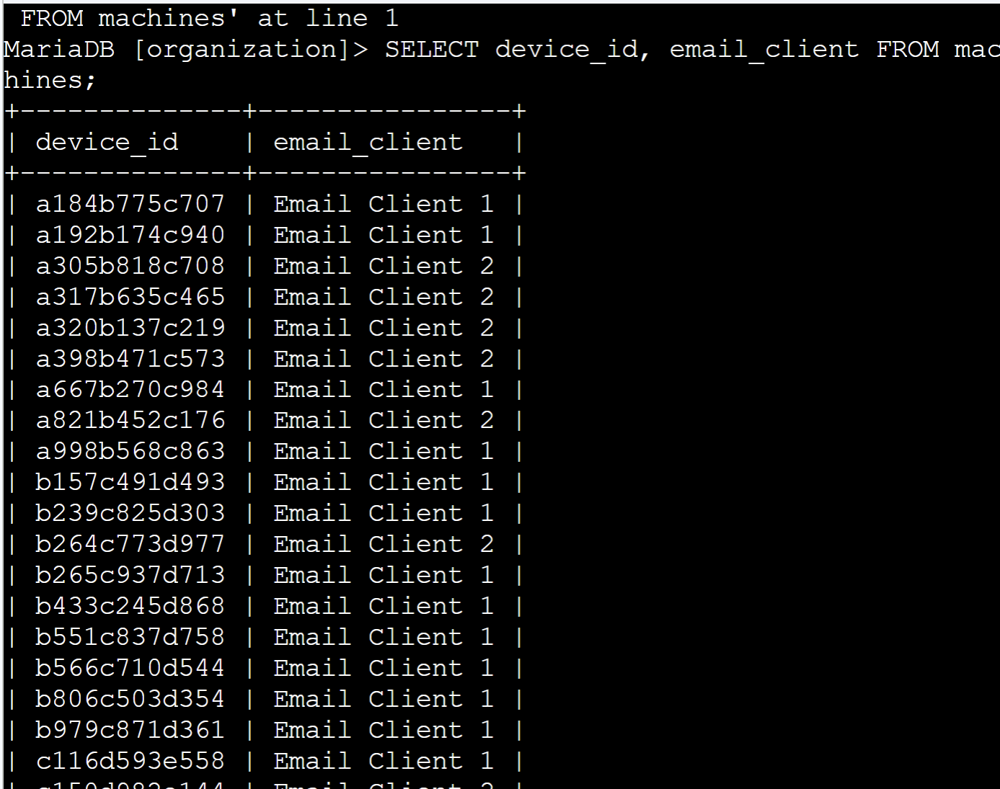
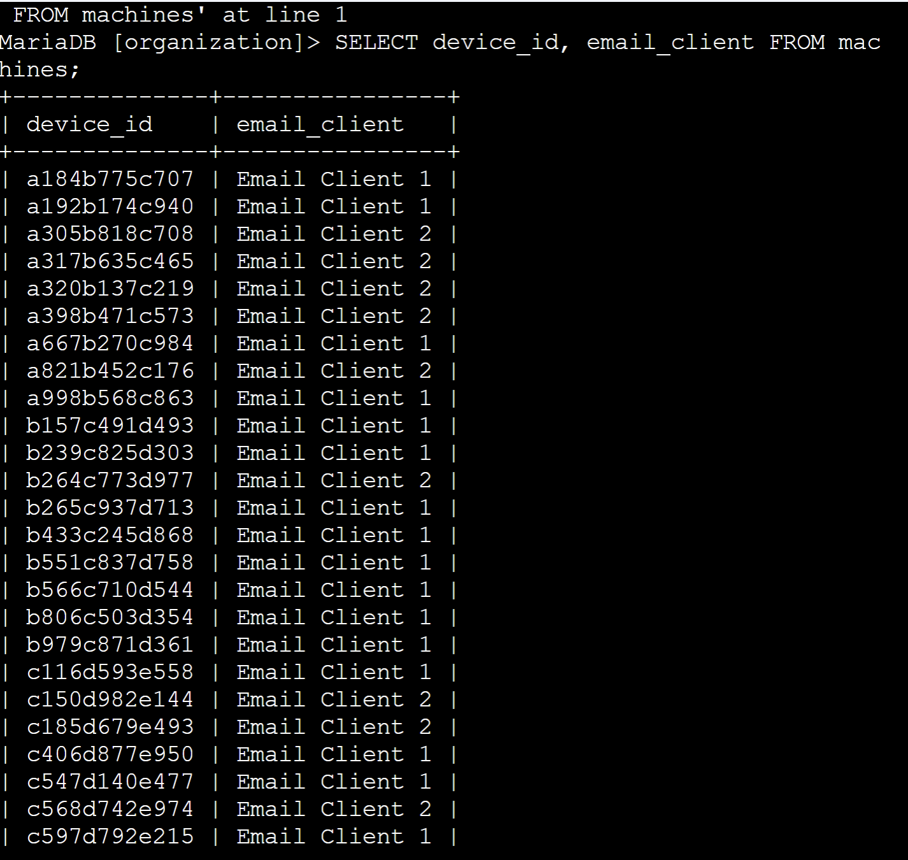
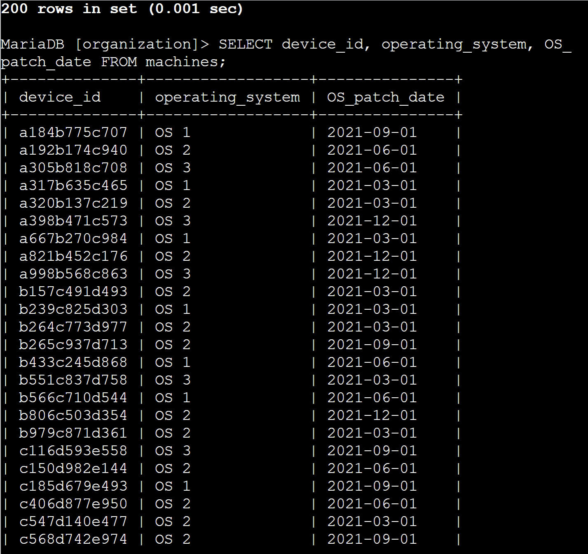
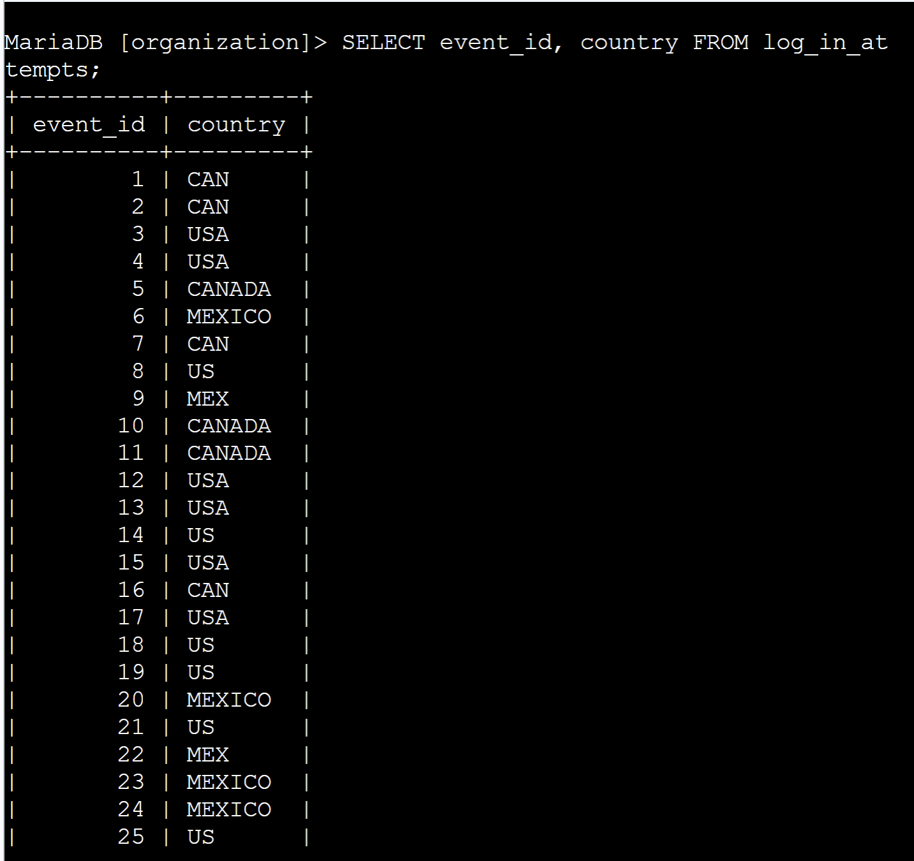
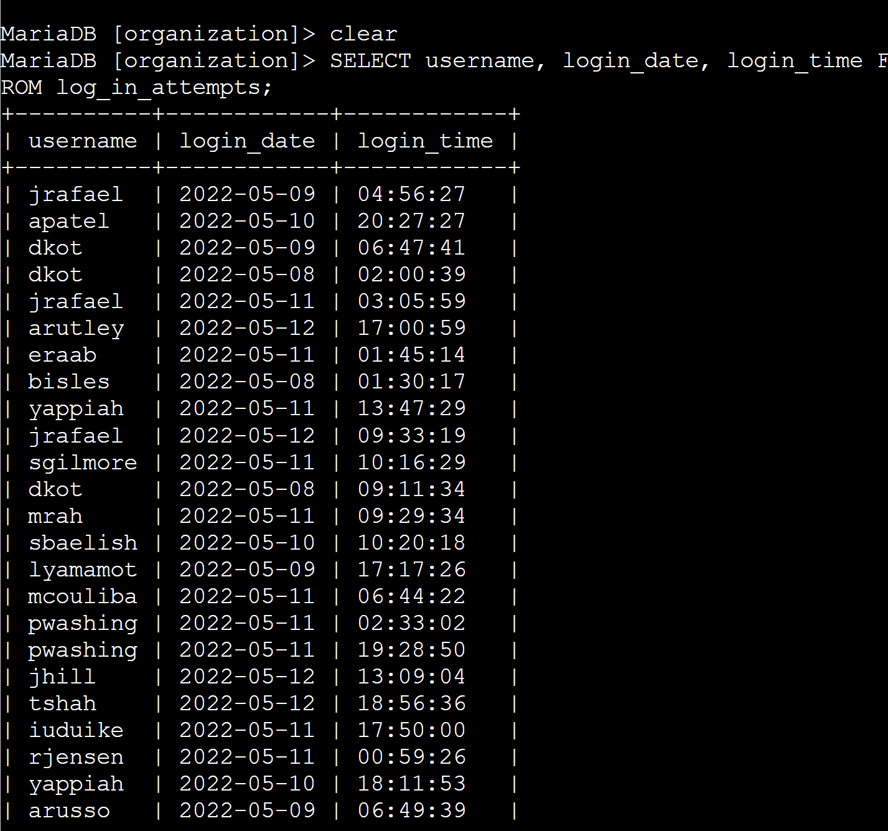
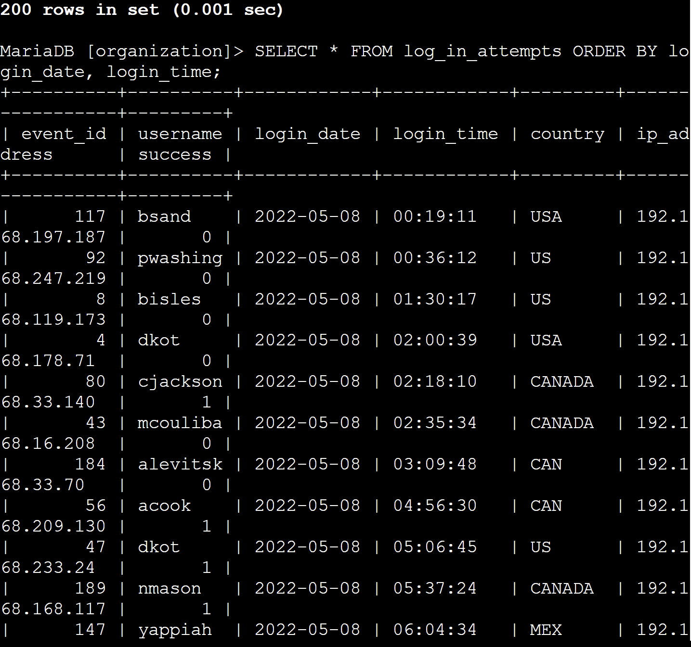
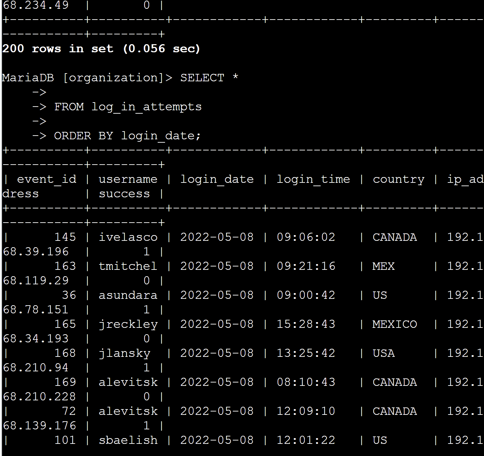

SQL for Security: Perform a SQL Query
Hands-on lab from the Google Cybersecurity Certificate, part of my path towards SOC / blue team analyst roles.
Scenario
A fictional organization needs to know which employee devices need updates and whether there is unusual login activity. The data is in two tables in the `organization` database: `machines` and `log_in_attempts`.
Tools
MariaDB shell, SQL (`SELECT`, `FROM`, `ORDER BY`)
What I did
1. Retrieve device data
Listed all 200 devices, then narrowed the output to email client, OS and patch dates.

2. Investigate login activity
Checked the `country` column for unexpected locations, then usernames with dates and times, then the full table.

3. Order the data
Sorted logins by date, then by date and time, to build a timeline.

Observations
Country values are inconsistent (US and USA, CAN and CANADA, MEX and MEXICO), so data would need cleaning before filtering.
Sorting by date and time puts the earliest-hours logins first, which makes after-hours activity easy to spot. Several have `success = 0`.
Scanning 200 rows by eye does not scale, so the next labs use `WHERE` and `LIKE`.
