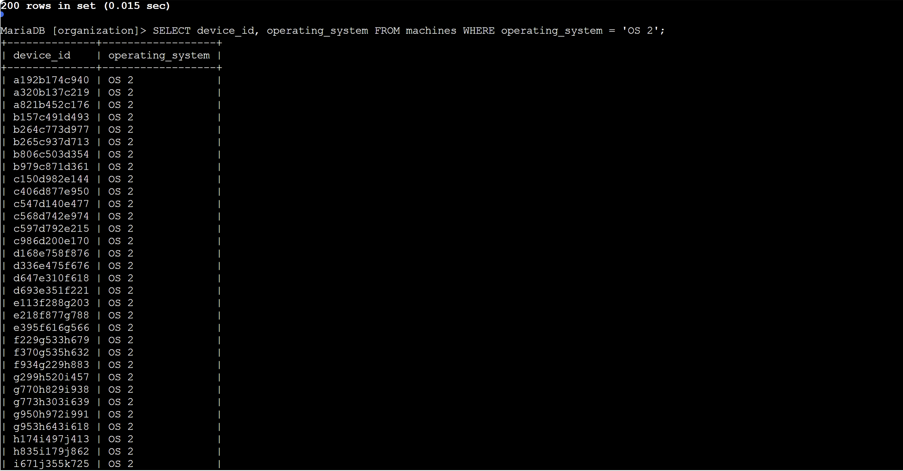
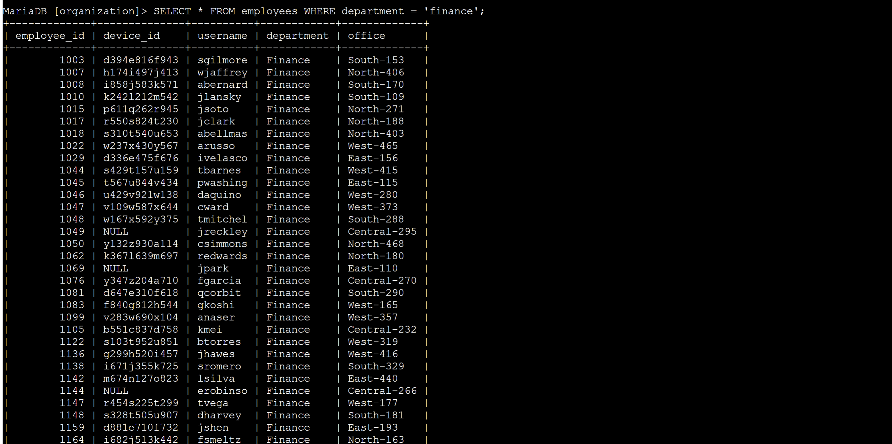
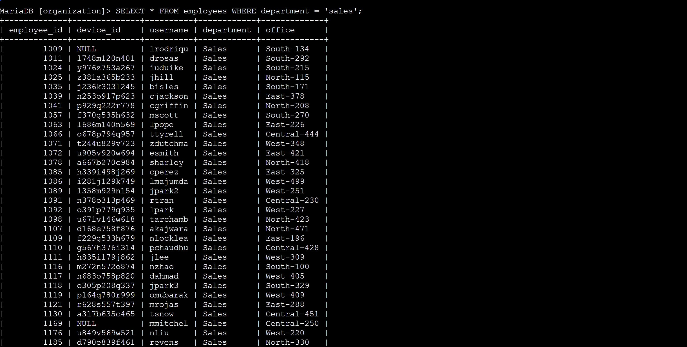
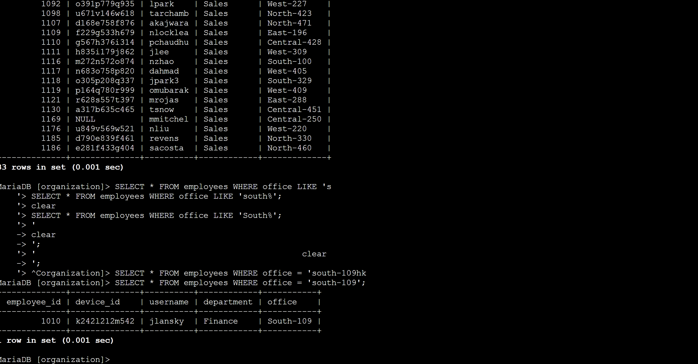
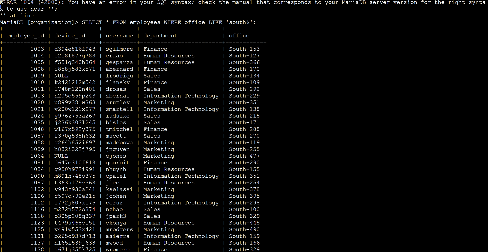

SQL for Security: Filter a SQL Query
Hands-on lab from the Google Cybersecurity Certificate, part of my path towards SOC / blue team analyst roles.
Scenario
Using the `organization` database, I filtered data about employees, their machines and their offices to support tasks like running updates, sending an alert to an employee, and finding everyone in a building affected by a machine issue.
Tools
MariaDB shell, SQL (`SELECT`, `FROM`, `WHERE`, `LIKE`, `%` wildcard)
What I did
1. Machines and operating systems
Listed every machine with its operating system, then filtered to a single OS to find the machines needing an update.

2. Employees by department
Filtered the `employees` table by department to find the people in Finance and in Sales.

3. Identify employee machines
Used an exact match on `office` to find the employee at one office, then `LIKE 'South%'` to find everyone in the whole South building.

Observations
`WHERE` returns only the rows that match, which beats scanning 200 rows by eye as in Lab 1.
Text values need single quotes, column names do not. A missing or extra quote left the shell stuck on a `'>` prompt, and closing the quote gets it back.
`=` needs an exact value, while `LIKE` with `%` matches a pattern. This suits cases like "every office in one building".
Matching on text was not case-sensitive in this database, so `'finance'` and `'Finance'` return the same rows.
Some employee rows have `NULL` in `device_id`, meaning no device is recorded for that employee. In a real environment that is an asset-tracking gap.
